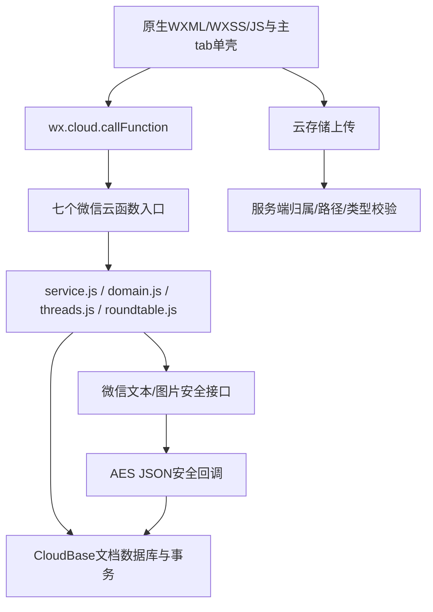

# 架构（以0.3.8代码为准）

不是自建HTTP后端、SQL或WebSocket。`cloudfunctions/*/index.js`通过官方wx-server-sdk构造同一业务服务，各部署包保留公共模块副本；`scripts/check.js`检查副本一致。不要只改其中一份。

- 身份来自云端`getWXContext()`，不能信任客户端author/openid/userInfo。配置目标环境与AppID必须匹配；集中配置后，各副本保持一致。
- `service.js`负责年龄、资料、记录、酒单、广场、审核、举报、清除；`domain.js`验证业务输入；`threads.js`处理根评论/回复线程；`roundtable.js`处理成员、申请、消息与事件游标。
- 主页面在一个壳中切换tab。已访问内容保留可见状态和滚动，后台刷新/去重/分页减少重复读取；这不代表首次加载已达标。
- 聊天使用前台增量轮询/历史分页与seq游标，不是长连接。隐藏/退出停止轮询；返回先鉴权，非成员清空旧的私有展示。会话变化不能复用旧私有缓存。
- 只短缓存已授权文件的签名链接，不缓存审核或权限结论；缓存有容量与TTL约束，成员变化仍需核验。
- `mine`表示相对于当前请求身份的本人消息；owner仅是桌主角色。乐观发送、失败重试、确认合并、历史/增量保持同一个mine语义。
- 没有客户端可调用的诊断造身份服务。本包的`tests/mock-cloud.js`只在Node离线测试中模拟数据库和SDK，不打入小程序。

测试分层：领域/服务内存测试、页面实例/组件状态、浏览器静态模板；官方平台审核、真实微信网络、原生CSS与设备性能需要独立真机证据。
